# Moss-FinAgent-Research

> **A multi-agent AI investment-research system for the secondary market.** Orchestrated by a LangGraph StateGraph Supervisor, with **19 agents across 5 layers**: data (A01-A04) / information (A05-A07) / analysis (A08-A12) / industry (A13-A16) / decision (A17) / audit (A18) / engineering (A19).
> Full-chain data lineage and every reasoning path are traceable.

<p align="center"><a href="README.md">中文</a> | English</p>

[](https://www.python.org/)
[](https://fastapi.tiangolo.com/)
[](https://react.dev/)
[](#ci--compliance-gates)
[](#ci--compliance-gates)

---

## Contents

- [What It Does](#what-it-does)
- [Demo](#demo)
- [Architecture Overview](#architecture-overview)
- [Three In-House Infrastructures](#three-in-house-infrastructures)
- [Engineering Discipline](#engineering-discipline)
- [Quick Start](#quick-start)
- [Trial Run](#trial-run)
- [CI / Compliance Gates](#ci--compliance-gates)
- [Known Limitations](#known-limitations)
- [Documentation Index](#documentation-index)

---

## What It Does

| Capability | Description | Key files |
|---|---|---|
| **AI investment research** | Input a ticker → Planner plans → data collection/cleaning/validation → information-layer debunking and event extraction → parallel macro/meso/micro/risk/compliance analysis → industry agents → ReAct consolidated recommendation → audit sealing | `src/orchestration/` |
| **Call-auction stock selection** (commercial) | Automatic pool at 9:25:00, 12-dimension scoring + 10 veto rules; rule table + bitmask engine, printable on a single page, per-stock decision traceable rule by rule | `src/auction_select/`, `auction_select/` (not committed) |
| **T-trading assistant** | Intraday buy/sell points, sentiment-cycle assessment, weight-profile editing | `src/intraday/`, `src/domain/intraday/` |
| **Quant factors & backtesting** | Factor library (IC/IR, 5-quantile layered backtests, turnover), VaR/CVaR, historical stress tests, Brinson attribution, parameter sensitivity | `src/quant/`, `src/backtest/` |
| **Quant selection / daily-K selection** (commercial) | Three-tier scheduled selection; LightGBM daily-K multi-factor selection written to the watchlist | `moss_selector/` (not committed) |
| **Fund flow / sector crowding** | Large-capital movements; ~6 years of concept-sector crowding percentile and alerts | `src/fundflow/`, `src/sector_crowding/` |
| **Mainline mining** | Three-stage funnel (six-dimension base → three-dimension accumulation traces → leader-resonance gate) to identify sector mainlines; alerts before/at launch; Walk-Forward backtest + six-chapter win-rate report; futures leading signals | `src/mainline/` |
| **ETF share monitoring** | Contrarian traces in broad-based ETF creation/redemption: share MoM / 5-10-20-day cumulative + index percentile + market-regime gate (opportunity signals only in bear markets); multi-product resonance; industry-ETF reversal warnings | `src/mainline/etf_*`, `configs/etf_flow.yaml` |
| **Alerts / intelligence** | Event-driven alerts; two-stage batch classification + scoring (2 LLM calls scan 30 candidates); Bocha Search + Baidu Qianfan with automatic failover between the two sources | `src/domain/alerts/`, `src/domain/intel/` |
| **Sector rotation daily** | Industry heatmap + main-capital flow + rule-based commentary | `src/sector_rotation/` |

---

## Demo

> The screenshots and screen recordings below were captured on a locally running instance (Sep-Oct 2026) with real market data from that period.
> Each heading is the original asset filename.

### 量化平台.png

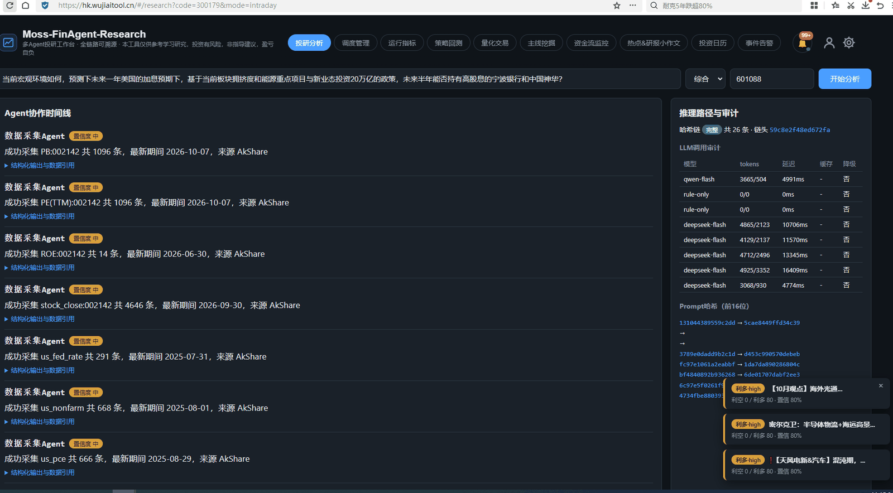

Platform overview: research entry point, analysis chain and result dashboards in one workspace.

### 复杂投研分析0930优化到26秒0930.gif

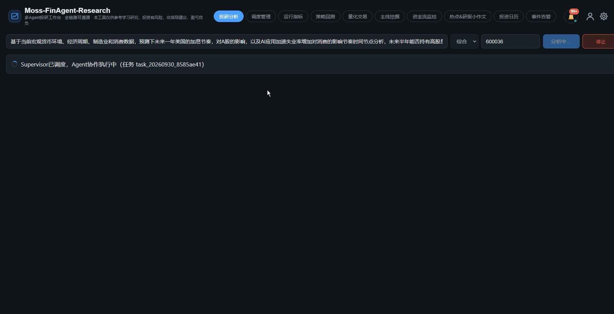

End-to-end recording of a complex question: the full A01-A18 chain runs from user input to report, in 26 seconds after optimization.

### 投资日历.png

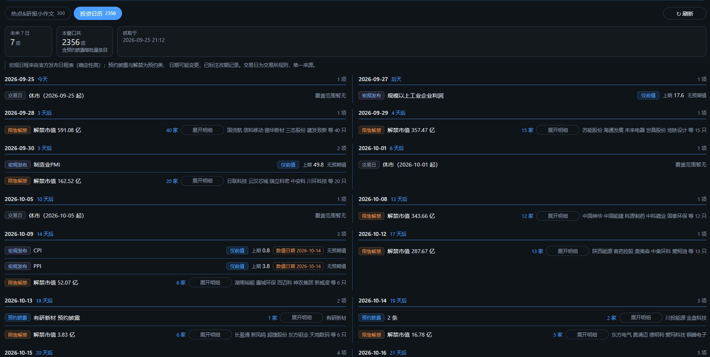

Investment calendar: earnings, macro releases, lock-up expiries and event dates on one calendar.

### 主线板块挖掘告警.png

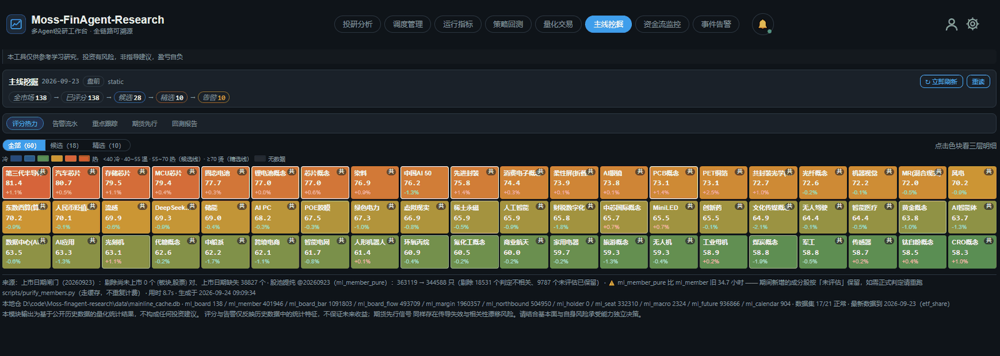

Mainline-sector mining alert: once the three-stage funnel identifies a mainline, an alert is pushed before or at its launch.

### 主线挖掘的历史几年的回测胜率.png

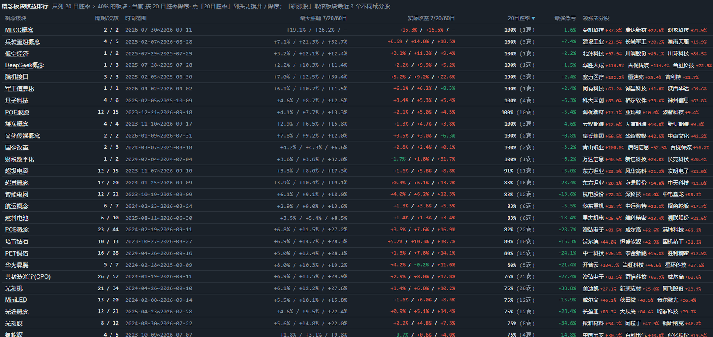

Multi-year Walk-Forward backtest win rate of mainline mining.

### 竞价选股功能.png

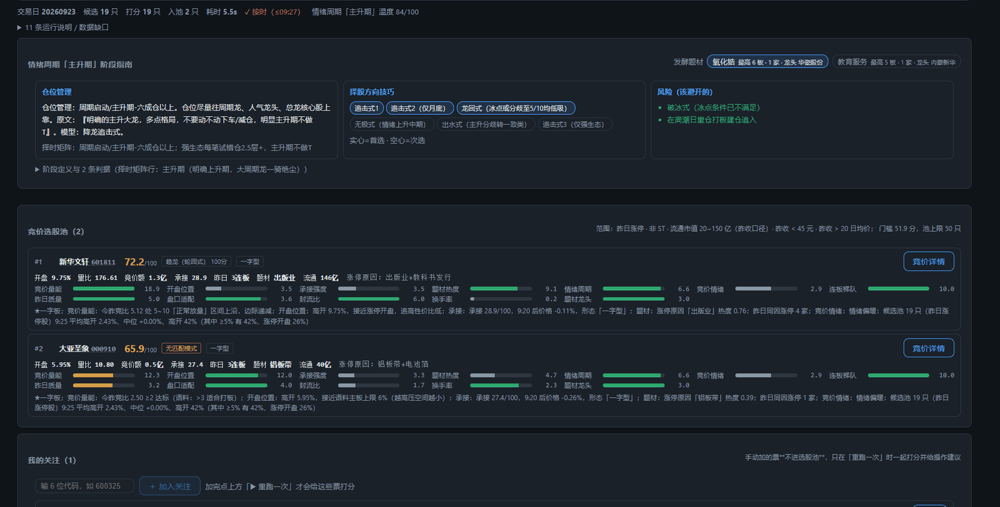

Call-auction stock selection: pool at 9:25, 12-dimension scoring + 10 veto rules, every decision traceable per stock.

### 宽基etf和行业ETF份额监控.png

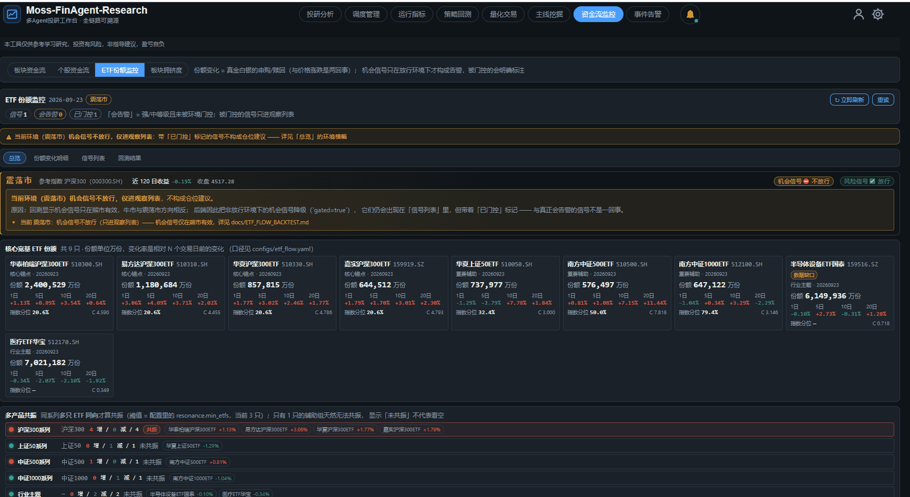

Broad-based and industry ETF share monitoring: share MoM, 5/10/20-day cumulative and index percentile.

### etf份额回测和机会风险提示（辅助机构仓位管理）.png

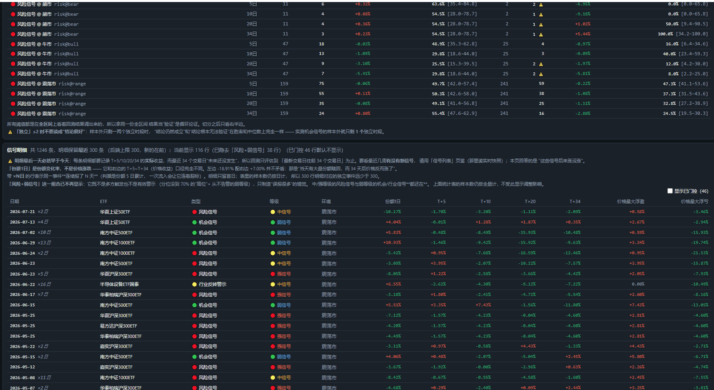

ETF share signal backtests plus opportunity/risk prompts for institutional position management.

### 板块资金流监控.png

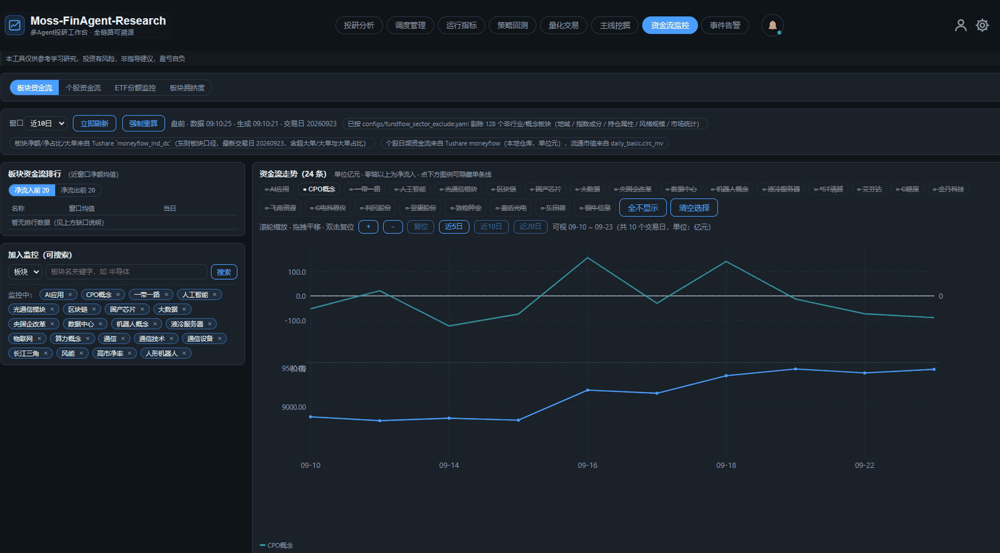

Sector fund-flow monitoring: main-capital net inflow/outflow and sector strength.

### 个股净流入净流出前20.png

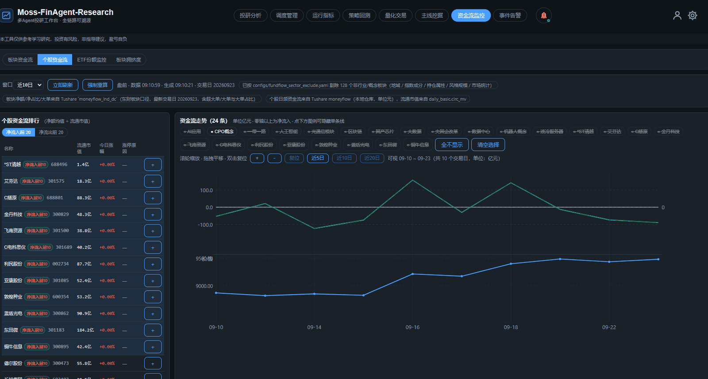

Top 20 stocks by net inflow/outflow.

### 策略回测（35因子和单股策略回测）.png

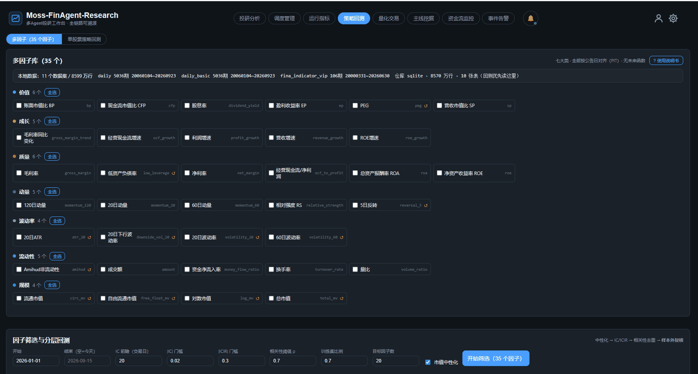

Backtest workbench: 35-factor portfolio backtests and single-instrument strategy backtests.

### 关键事件的自动检索报警功能.png

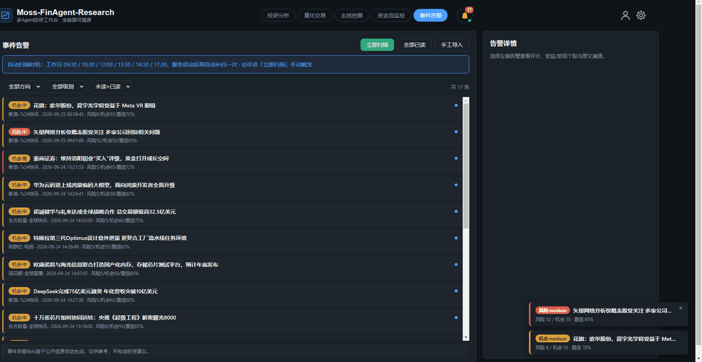

Automatic retrieval and alerting of key events.

### 重大政策及事件，实时监控和评估影响面板2.png

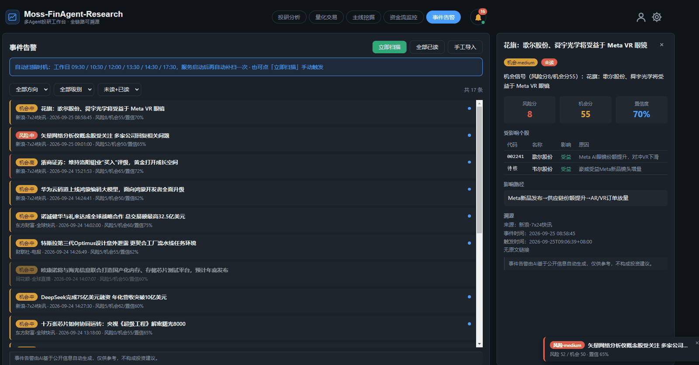

Real-time monitoring and impact-assessment panel for major policies and events.

---

## Architecture Overview

### Layers

```
src/
├── api/                         HTTP interface layer (22 main routers + 2 private try/except)
│   ├── routes/                  auth · admin · research · alerts · backtest · fundflow ·
│   │                            intraday · quant · mainline · sector_crowding · sector_rotation ·
│   │                            intel · data · scheduler · metrics · code_engineer · skills · …
│   ├── main.py / runtime.py     FastAPI assembly, dependency injection, event wiring
│   ├── tasks.py / alert_hub.py  async task management, alert broadcasting
│   └── exception_handlers.py / errors.py / error_codes.py
├── orchestration/               LangGraph StateGraph orchestration + Planner
│   ├── supervisor.py            supervisor graph (fan-out / fan-in / ReAct)
│   ├── planner.py               LLM-driven metric planning
│   └── message_bus.py
├── domain/                      business domain (**no dependency on infrastructure implementations**)
│   ├── agents/
│   │   ├── data/                A01 collect · A02 clean · A03 validate · A04 store
│   │   ├── info/                A05 debunk · A06 extract · A07 sentiment
│   │   ├── analysis/            A08 macro · A09 meso · A10 micro · A11 risk · A12 compliance
│   │   ├── industry/            A13 tech · A14 consumer · A15 cyclical · A16 healthcare (+ generic fallback)
│   │   ├── decision/            A17 consolidated recommendation (ReAct)
│   │   ├── audit/               A18 audit (hash chain, **zero LLM**)
│   │   └── engineering/         A19 code engineer (self-learning data completion)
│   ├── alerts/ intel/ indicators/ intraday/ quota/ auth/ skills/ platform/
├── core/                        single authoritative layer: config · exceptions · cancellation tokens · shared conventions
│   ├── base_agent.py / state.py / message.py
│   ├── config.py / models.py / schemas.py
│   ├── market_constants.py      market conventions (price limits / market cap / annualized trading days)
│   ├── trading_session.py       A-share session boundaries (09:15 / 09:30 / 11:30 / 13:00 / 15:00)
│   ├── symbols.py               sh/sz prefix conversion (**only here**)
│   ├── errors.py / exceptions.py / redaction.py
│   ├── budget.py / cancel.py / inflight.py / loop_lag.py / hop_stats.py
│   ├── logging_setup.py         src namespace HANDLER (prevents INFO logs from being dropped)
│   └── intel_limits.py          interactive-path deadline (default 10s; MOSS_QUERY_DEADLINE_SEC in .env)
├── infrastructure/              technical implementations
│   ├── llm/                     gateway · cache · circuit breaker · audit · providers · rate gate · VRAM
│   ├── connectors/              data-source connectors + routing (three-level failover, event collectors)
│   ├── repositories/            repository implementations (SQLite/Postgres, RLS / audit chain / events / user pools)
│   ├── catalog/                 metric catalog · frequency inference · source-column index · synonyms · web fallback
│   ├── search/                  Bocha / Baidu Qianfan
│   ├── notifiers/               email and other channels
│   └── security/rls.py          PostgreSQL native RLS, dual-layer isolation
├── quant/                       data warehouse · factors · backtesting · risk (**core**)
├── auction_select/              call-auction stock selection (commercial, **directory not committed**; held locally)
├── intraday/                    T-trading assistant (**core**)
├── backtest/                    short-term / single-instrument backtesting
├── fundflow/                    fund-flow monitoring
├── sector_crowding/             sector crowding
├── sector_rotation/             sector rotation daily
├── mainline/                    mainline mining (three-stage funnel / futures / ETF / Walk-Forward)
└── scheduler/                   Celery Beat registry + JSONL run records + admin API

auction_select/                  ← commercial directory (not committed; held locally)
moss_selector/                   ← quant selection (not committed; held locally)
qmt/                             ← QMT market-data integration (README + SIGNAL_CONTRACT committed)
configs/                         global config (model routing / data sources / strategy sources / metric catalog)
```

**Dependency direction**: `api → orchestration → domain → infrastructure` (one-way).
`domain` depends only on the **interfaces** exposed by `infrastructure`; concrete implementations are injected by `api/runtime.py`.

### Call chain of one research analysis

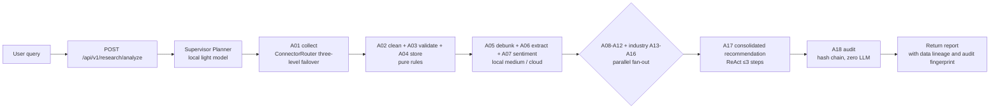

---

## Three In-House Infrastructures

### 1 · LLM gateway (`src/infrastructure/llm/`)

**Architecture red line: every LLM call must go through the gateway; agents must never call a model API directly.**

```
complete(tier, system, prompt)
  ├─ cancellation-token check  intercept before the call; no cost after the user hits stop
  ├─ input truncation          keep head and tail (tail = instructions and JSON schema)
  ├─ cache                     exact + semantic, partitioned by model tier + json_mode + agent
  ├─ token budget              reject once a task's cumulative usage exceeds the limit
  ├─ rate gate                 provider-level sliding window
  ├─ circuit breaker           provider-level state machine
  └─ fallback chain            primary → backup → fail-closed, fully audited
```

Supporting pieces: **semantic cache**, **prompt/response hash audit chain**, and **tier-based model routing**
(`local_light=qwen2.5:1.5b-instruct-q4_K_M`, `local_medium=qwen3.5:4b`,
`local_reasoning=deepseek-r1:7b`; see `configs/models.yaml`).

### 2 · Data-connector routing (`src/infrastructure/connectors/`)

```
tiered TTL cache → per-key lock (anti-stampede) → daily chain: AkShare → Tencent → Tushare → baostock
                                                             → [local CSV switch LOCAL_QUOTE_DIR]
                                                             → [QMT switch, last, off by default]
       minute/intraday/snapshot chain: Tencent → Sina → Eastmoney → [QMT switch, last]
```

- **Tiered TTL**: monthly macro 24h / valuation 12h / quotes 4h / real-time liquidity 5min.
- **Hard constraint**: when all real sources fail, **never fall back to simulated**; report the gap instead.
  Fake data inside an investment recommendation is far more dangerous than "no data this time".

### 3 · Self-learning data completion (`A19 DataGapResolverAgent`)

```
metric has no data → LLM generates a connector
                ├─ ① AST static validation (no import os/subprocess, no eval)
                └─ ② subprocess sandbox smoke test (15s timeout)
                      ↓ both pass
                     registered in DB, reused afterwards
```

> ⚠️ The sandbox is **process-level isolation, not a security container**. It suits "semi-trusted"
> generated code on small-scale data sources only. The boundary is in `docs/CODE_AUDIT_CHECKLIST.md`.

---

## Engineering Discipline

| Discipline | How it is enforced |
|---|---|
| **Reproducible** | data is always fetched by a pinned `trade_date`, never inferred from the "real-time clock" |
| **Never guess** | missing data is set to `None` and marked `degraded`, never replaced with 0 or a neutral value |
| **Traceable** | every data point carries `source_url / publish_time / fetch_time / raw_content_hash`; every LLM call carries `prompt_hash / tokens / latency / fallback chain` |
| **Allow-list driven** | agent data visibility is enforced by `supervisor._AGENT_DATA_WHITELIST`, matched strictly by `en_id` / family prefix |
| **Pure refactors need golden regressions** | auction-selection refactor compared bit-for-bit against frozen quote tapes (47 stocks × 12 dimensions) + performance-gate unit tests |
| **Rules must be readable** | decision rules converge into declarative tables; `python -m src.auction_select.rulebook --dump` prints one page |
| **Testing** | 360+ unit-test files (`tests/unit`), 10 integration tests; gates in CI (see §8) |
| **Do not delete others' temporary files** | `AGENTS.md` "AI collaboration guardrails" §30: name every file individually, no wildcards, `git status` first |

### A real refactor (architecture-evolution case)

Auction-selection decisions were originally scattered across 4 files as **329 `if/elif` branches**, with implicit ordering
constraints ("rule 6 must run before rule 5"). They were rebuilt as a **master rule table + bitmask engine**:

| Metric | Before | After |
|---|---:|---:|
| Rule readability | 4 files, 3853 lines | `--dump` prints one page |
| Implicit ordering coupling | yes | **0** (Pass 1 tags / Pass 2 vetoes; two pure-function passes) |
| Decision-path latency | 1231 ms | **36 ms (34×)** |
| Behavioral consistency | — | golden regression, **564 checkpoints bit-identical** |

> **The key finding**: the bottleneck was **not the rules** (rules accounted for only 8.1 ms / 0.66%),
> but reading three full-market tables every round in the ecosystem sequence (1223 ms / 99.3%).
> The optimization target was moving day-stable results out of the hot path — not optimizing the rules themselves.

---

## Quick Start

```bash
# 1. Dependencies (Python ≥ 3.10 + uv required)
uv sync

# 2. Start the local database (SQLite needs zero setup at this stage; PG/Redis optional)
docker compose up -d

# 3. Environment variables
cp .env.example .env      # fill in DEEPSEEK_API_KEY etc.
                            # ⚠️ credentials for external online sources (bocha_search / baidusearch)
                            # must be written to the project-root .env; the process cannot inherit them from the environment

# 4. Start the API (port 8100 on localhost)
$env:PYTHONPATH="."       # bash: export PYTHONPATH=.
uv run uvicorn src.api.main:app --port 8100
# or use the management script (background + logs + graceful restart)
uv run python manage.py start --replace --daemon

# 5. Frontend (5173)
uv run python manage.py web
# or build once into web/dist (the backend can serve it)
uv run python manage.py build

# 6. Tests (only tests affected by the current change)
uv run python scripts/affected_tests.py --run
# full suite (only before commit/push)
uv run pytest
```

### External online sources (check every day before use)

```bash
# exit 0 = all available / 3 = some source rejected / 2 = the probe itself is broken
uv run python scripts/check_external_sources.py
```

| Source | Role | Status (2026-10-01) |
|---|---|---|
| **Bocha Search** (`bocha_search`) | primary search source (path C) | ✅ available (one-time quota 1000) |
| **Baidu Qianfan Smart Search** (`baidusearch`) | search fallback | ✅ available (100/day) |
| **Eastmoney Choice EMQuantAPI** | data connector (**not a search source**) | ⛔ account lacks the "quant API" permission (`code:160`) |

See `docs/PRD.md` §19.33.

---

## Trial Run

> ⚠️ **The trial-run script targets the `dev` instance on 8100** (`data/dev/`). **8110 is the external pilot (`pilot`)**,
> which forces login site-wide ⇒ an anonymous tour gets `HTTP 401` at step 1.
> **Start the service before running the tour** (this command used to appear only under "Start the API", not under
> "Trial Run", so following the Trial Run section alone always ended in `ConnectionRefused`):

```powershell
# 0. Prerequisite: start the dev instance (background + logs at data/run/backend-dev.log)
.\.venv\Scripts\python.exe manage.py start --daemon
.\.venv\Scripts\python.exe manage.py status      # expected: backend API 8100 running for this project

# Seven-step tour: PASS/FAIL per step, including the risk statement (recommended opener for a trial run)
.\.venv\Scripts\python.exe scripts/demo_tour.py
# includes a real-market backtest (async job, wait a few dozen seconds)
.\.venv\Scripts\python.exe scripts/demo_tour.py --with-backtest
# Step 5 "Scheduler" is admin-only: without credentials it asserts "anonymous must be rejected" (401/403 = PASS);
# pass an admin session cookie to read the real job list
.\.venv\Scripts\python.exe scripts/demo_tour.py --admin-cookie "moss_session=..."

# Warm up trial-run data (idempotent)
.\.venv\Scripts\python.exe scripts/seed_demo_data.py

# Auction rule table / per-stock decision trace (**commercial**; commands are missing when the directory is not committed)
.\.venv\Scripts\python.exe -m src.auction_select.rulebook --dump
.\.venv\Scripts\python.exe -m src.auction_select.rulebook --explain 600630 --trade-date 20260918

# End-to-end engineering smoke test
.\.venv\Scripts\python.exe scripts/_smoke_e2e.py

# Standalone backtest-engine trial run (--synthetic uses deterministic synthetic data to verify the mechanics)
.\.venv\Scripts\python.exe scripts/backtest_demo.py
```

**Full trial-run playbook: [`docs/DEMO_GUIDE.md`](docs/DEMO_GUIDE.md).**

### Multi-user: administrators and approval (**run this first on a fresh deployment**)

Registration is **approval-based**: a new user is `pending` after sign-up and **cannot log in** until an administrator
approves them in "User Management". The admin console itself requires an administrator — so **the first administrator
cannot be created through the UI**; the deployer must create it explicitly with server access:

```powershell
# Create the first administrator (prints an initial password once; save it immediately)
.\.venv\Scripts\python.exe scripts/bootstrap_admin.py `
    --username admin --email you@example.com --db data/dev/moss_dev.db

# List current administrators / promote an existing user to administrator
.\.venv\Scripts\python.exe scripts/bootstrap_admin.py --list --db data/dev/moss_dev.db
.\.venv\Scripts\python.exe scripts/bootstrap_admin.py --promote someone --db data/dev/moss_dev.db
```

**Mind `--db`**: `manage.py start` defaults to the **isolated dev instance** (`data/dev/moss_dev.db`); without `--db`
the administrator is created in `data/moss_finagent.db` — both "succeed" but cannot see each other, which looks like
"I created an administrator but login says the account does not exist". The script prints the actual DB path and size on
its first line; **check it first**.

After login, the account area appears at the far right of the top bar; administrators also get a **"User Management"** tab:

| Capability | Description |
|---|---|
| Pending approvals | the header shows "N pending"; approve in one pass (choose plan + validity + note) |
| Create account directly | skip email verification; the administrator sets the initial password; optional force password change on first login |
| Plan tiers | Admin / VIP (100 per pool, 100 total) / Trial (5 per pool, 25 total) |
| Validity | set as "today + N days"; after expiry **read-only**, renewable at any time |
| Disable / enable | a disabled user cannot log in immediately |
| Forgot-password fallback | the administrator can reset a user's password (all that user's devices are logged out) |
| Force logout | kick all devices of a user (for suspected account theft) |
| Delete account | **soft delete** (audit chain retained); the **email is released** and can register again |

Two deliberate restrictions (**enforced server-side**):

1. **An administrator cannot change their own plan tier, nor disable/delete themselves** —
   otherwise they would lose the only way into the admin console and would need database surgery to recover;
2. **Every admin action is logged** (who, to whom, what changed, from what to what) —
   an anonymous administrator is equivalent to no administrator from a compliance standpoint
   (the four-eyes principle requires actions attributable to a person).

### Multi-user: the three pages available to regular users

After login, the top bar gains two groups of entries, both **isolated per user**:

| Page | Isolation |
|---|---|
| **My watchlist** | ⚠️ **Removed on 2026-09-23** (user feedback: "too gimmicky, not needed") — the `my_pools` route and `intradayWatchlistMine` were removed; add/remove now writes directly to `configs/intraday.yaml`. **The watchlist is still global**; per-account isolation is a TODO (`docs/PRD.md` §50.6, `CHG-0224`) |
| **Custom sectors** | ✅ per-account isolation (2026-10-08, `CHG-0223`): ownership key `user_id`, `UNIQUE(user_id, name)`, cross-tenant access returns 404; quota 20×200 (trial 5×50). See `docs/PRD.md` §50.5 |
| **Per-stock conventions** | each user has their own copy for the same stock; `from_user` marks "customized" vs "following system default" |
| **User management** (admin only) | every endpoint enforces `applied_tier == 'admin'` server-side |

**Quotas are enforced server-side per plan** (`applied_tier` → the quota table is defined in exactly one place,
`src/domain/quota/service.py`):

| Plan | Pools | Per pool | Watchlist total (deduplicated) |
|---|---|---|---|
| Admin | 5 | 100 | 100 |
| VIP | 5 | 100 | 100 |
| Trial | 5 | 5 | 25 |

Sector members **do not** count toward the watchlist total (and do not enter the real-time data universe) —
otherwise "I added a sector and my watchlist is full".

---

## CI / Compliance Gates

`.github/workflows/ci.yml` has three jobs, all permanent contracts:

| Job | Content | On failure |
|---|---|---|
| **Backend** | Python 3.11 + 3.13; `uv sync` → ruff lint → full pytest | blocking |
| **Frontend** | Node 20; `npm ci` → type check → `npm run build` | blocking |
| **Compliance** | `test_compliance_gate` + `test_tenancy` + `verify_cleanup` + `test_market_constants` + `test_trading_session` + secret scanning + `prd_sync_check --self-test/--ledger` + `test_auction_golden` | **blocks merge** |

The compliance job is handled differently from ordinary unit-test failures — if it fails, **merging is not allowed**
(each test maps to a regulatory or internal-control requirement).

Requirement-sync gate (`prd_sync_check.py`):

```bash
uv run python scripts/prd_sync_check.py --keyword "<keyword>"  # three-state verdict
uv run python scripts/prd_sync_check.py --ledger                # ledger integrity (0 ERROR before delivery)
uv run python scripts/prd_sync_check.py --self-test            # the checker itself is trustworthy
```

Discipline: `.trae/skills/requirement-prd-sync/SKILL.md`;
ledger: `docs/REQUIREMENT_CHANGELOG.md`;
evidence base: `docs/PRD_ALIGNMENT_AUDIT_20260928.md`.

---

## Known Limitations

No polishing, listed openly:

| Limitation | Current state | Improvement path |
|---|---|---|
| **Single process + SQLite** | a deliberate choice for this stage (zero-dependency, easy to deploy) | the repository layer is abstracted; switching to PostgreSQL is a config change |
| **Tight allow-list for external online sources** | Bocha/Baidu quotas (1000 total / 100 per day) | add other cloud sources and explicitly opt out of local-first |
| **Semantic cache is character 3-gram cosine** | lightweight and dependency-free; discrimination drops on long prompts | switch to embeddings + vector DB; disable the semantic layer for long prompts and keep exact matching |
| **Cost accounting loop is not closed** | `models.yaml` has a pricing block but the gateway ignores it; only tokens are counted, not money | the gateway writes `cost_yuan` = tokens × unit price into the audit record |
| **Large files** | `src/intraday/service.py` 2526 lines, `src/auction_select/sources.py` 1482 lines | split by responsibility (see `docs/PROJECT_AUDIT_2026-09-19.md`) |
| **No live-trading validation for backtests** | three-tier model backtests declare in-sample assumptions and slippage sensitivity | rolling out-of-sample + finer transaction costs |
| **Public edition excludes commercial modules** | `src/auction_select/`, `moss_selector/`, `src/intraday/niuline.py` etc. are in `.gitignore` and **are not** committed; `src/api/routes/__init__.py` silently skips them via try/except | holding the commercial modules locally restores route registration |

---

## Documentation Index

### Architecture & design

| Document | Content |
|---|---|
| [`docs/ARCHITECTURE.md`](docs/ARCHITECTURE.md) | System architecture |
| [`docs/ARCHITECTURE_DEEP_DIVE.md`](docs/ARCHITECTURE_DEEP_DIVE.md) | Architecture deep dive |
| [`docs/ARCHITECTURE_PANORAMA_20260930.md`](docs/ARCHITECTURE_PANORAMA_20260930.md) | Panorama (2026-09-30) |
| [`docs/FRONTEND_DESIGN.md`](docs/FRONTEND_DESIGN.md) | Frontend design |
| [`docs/OBSERVABILITY.md`](docs/OBSERVABILITY.md) | Metrics, audit chain and observability |
| [`docs/SCHEDULER_DESIGN.md`](docs/SCHEDULER_DESIGN.md) | Scheduler design |
| [`docs/RUNTIME_SAFETY_ARCHITECTURE.md`](docs/RUNTIME_SAFETY_ARCHITECTURE.md) | Runtime safety architecture |

### Project material & archive

| Document | Content |
|---|---|
| [`docs/RESUME_PROJECT.md`](docs/RESUME_PROJECT.md) | **Project introduction (A/B versions + in-depth Q&A)** |
| [`docs/DESIGN_HIGHLIGHTS.md`](docs/DESIGN_HIGHLIGHTS.md) | Design highlights and challenges |
| [`docs/DEMO_GUIDE.md`](docs/DEMO_GUIDE.md) | Trial-run playbook and talking points |
| [`docs/INTERVIEW_FINAL.md`](docs/INTERVIEW_FINAL.md) | Consolidated in-depth Q&A (most authoritative) |
| [`docs/INTERVIEW_PLAYBOOK.md`](docs/INTERVIEW_PLAYBOOK.md) | In-depth Q&A handbook |
| [`docs/INTERVIEW_NOTES.md`](docs/INTERVIEW_NOTES.md) | Q&A notes |
| [`docs/INTERVIEW_TECH_PANORAMA_20260930.md`](docs/INTERVIEW_TECH_PANORAMA_20260930.md) | Technical panorama |

### Security / compliance / multi-tenancy

| Document | Content |
|---|---|
| [`docs/SECURITY_COMPLIANCE.md`](docs/SECURITY_COMPLIANCE.md) | Security and compliance |
| [`docs/MULTI_TENANCY_DESIGN.md`](docs/MULTI_TENANCY_DESIGN.md) | Multi-tenancy and compliance design (RBAC × ABAC × information barriers) |
| [`docs/PLATFORM_MULTI_TENANCY_DESIGN.md`](docs/PLATFORM_MULTI_TENANCY_DESIGN.md) | Platform multi-tenancy and permissions (three-level resource ownership + module capability codes + dual-layer RLS isolation) |
| [`docs/CODE_AUDIT_CHECKLIST.md`](docs/CODE_AUDIT_CHECKLIST.md) | Code audit checklist |

### Business modules

| Document | Content |
|---|---|
| [`docs/AUCTION_SELECT.md`](docs/AUCTION_SELECT.md) | Call-auction stock selection (rule table, convention checks) |
| [`docs/AUCTION_DATA_REDUNDANCY.md`](docs/AUCTION_DATA_REDUNDANCY.md) | Call-auction data redundancy-chain audit |
| [`docs/INTRADAY_T_DESIGN.md`](docs/INTRADAY_T_DESIGN.md) | T-trading assistant design |
| [`docs/INTRADAY_T_OPERATION_GUIDE.md`](docs/INTRADAY_T_OPERATION_GUIDE.md) | T-trading operations guide |
| [`docs/QUANT_DATA_WAREHOUSE.md`](docs/QUANT_DATA_WAREHOUSE.md) | Quant data warehouse |
| [`docs/QUANT_M1_DATA_LAYER.md`](docs/QUANT_M1_DATA_LAYER.md) | Quant data layer |
| [`docs/QUANT_M2_FACTORS.md`](docs/QUANT_M2_FACTORS.md) | Factor library and IC/IR |
| [`docs/QUANT_M4_SINGLE_BACKTEST.md`](docs/QUANT_M4_SINGLE_BACKTEST.md) | Single-instrument backtesting |
| [`docs/QUANT_SELECT.md`](docs/QUANT_SELECT.md) | Quant stock selection |
| [`docs/QUANT_STRATEGY_CASES.md`](docs/QUANT_STRATEGY_CASES.md) | Quant strategy cases |
| [`docs/SHORTTERM_BACKTEST.md`](docs/SHORTTERM_BACKTEST.md) | Short-term backtesting |
| [`docs/SELECTOR_DAILY_K.md`](docs/SELECTOR_DAILY_K.md) | Daily-K stock selection |
| [`docs/SECTOR_CROWDING.md`](docs/SECTOR_CROWDING.md) | Sector crowding |
| [`docs/SECTOR_ROTATION.md`](docs/SECTOR_ROTATION.md) | Sector rotation daily |
| [`docs/FUND_FLOW_MONITOR.md`](docs/FUND_FLOW_MONITOR.md) | Fund-flow monitoring |
| [`docs/MAINLINE_MINING.md`](docs/MAINLINE_MINING.md) | Mainline mining (three-stage funnel / futures / Walk-Forward) |
| [`docs/ETF_FLOW_MONITOR.md`](docs/ETF_FLOW_MONITOR.md) | ETF share monitoring |
| [`docs/ETF_FLOW_DATA_QUALITY.md`](docs/ETF_FLOW_DATA_QUALITY.md) | ETF data quality |
| [`docs/ETF_FLOW_BACKTEST.md`](docs/ETF_FLOW_BACKTEST.md) | ETF share signal backtest report |
| [`docs/ETF_BOARD_MAPPING.md`](docs/ETF_BOARD_MAPPING.md) | ETF-sector mapping |
| [`docs/ETF_REGIME_RULES_BACKTEST.md`](docs/ETF_REGIME_RULES_BACKTEST.md) | ETF regime-rule backtest |
| [`docs/INTEGRATION_PLAN_zsxq_intel.md`](docs/INTEGRATION_PLAN_zsxq_intel.md) | Zsxq intelligence integration |
| [`docs/INTEL_CENTER_REDESIGN.md`](docs/INTEL_CENTER_REDESIGN.md) | Intelligence center redesign |
| [`docs/INTEL_PERMISSION_DESIGN.md`](docs/INTEL_PERMISSION_DESIGN.md) | Intelligence permission design |
| [`docs/INVESTMENT_CALENDAR_DESIGN.md`](docs/INVESTMENT_CALENDAR_DESIGN.md) | Investment calendar design |

### Performance / data / pipelines

| Document | Content |
|---|---|
| [`docs/PERFORMANCE_OPTIMIZATION_2026-09-15.md`](docs/PERFORMANCE_OPTIMIZATION_2026-09-15.md) | Performance optimization (2026-09-15) |
| [`docs/END_TO_END_OPTIMIZATION_2026-09-28.md`](docs/END_TO_END_OPTIMIZATION_2026-09-28.md) | End-to-end optimization (2026-09-28) |
| [`docs/OPTIMIZATION_SUMMARY_2026-09-27.md`](docs/OPTIMIZATION_SUMMARY_2026-09-27.md) | Optimization summary (2026-09-27) |
| [`docs/LATENCY_OPTIMIZATION.md`](docs/LATENCY_OPTIMIZATION.md) | Latency optimization |
| [`docs/PANEL_LOAD_LATENCY.md`](docs/PANEL_LOAD_LATENCY.md) | Panel load latency |
| [`docs/PANEL_PREFETCH_KEEPALIVE.md`](docs/PANEL_PREFETCH_KEEPALIVE.md) | Panel prefetch and KeepAlive |
| [`docs/TOKEN_OPTIMIZATION.md`](docs/TOKEN_OPTIMIZATION.md) | Token optimization |
| [`docs/LLM_ROUTING.md`](docs/LLM_ROUTING.md) | LLM routing |
| [`docs/LLM_MODEL_SELECTION_RESEARCH_20260928.md`](docs/LLM_MODEL_SELECTION_RESEARCH_20260928.md) | LLM model-selection research |
| [`docs/DATA_ACQUISITION_FLOW.md`](docs/DATA_ACQUISITION_FLOW.md) | Data acquisition flow |
| [`docs/DATA_CONTRACT.md`](docs/DATA_CONTRACT.md) | Data contract |
| [`docs/DATA_FRESHNESS_ARCHITECTURE.md`](docs/DATA_FRESHNESS_ARCHITECTURE.md) | Data-freshness architecture |
| [`docs/DATA_INDEX_REQUIREMENTS_AUDIT.md`](docs/DATA_INDEX_REQUIREMENTS_AUDIT.md) | Data index requirements audit |
| [`docs/DATA_PIPELINE_DIAGNOSIS.md`](docs/DATA_PIPELINE_DIAGNOSIS.md) | Data pipeline diagnosis |
| [`docs/DATA_SOURCE_INTEGRATION.md`](docs/DATA_SOURCE_INTEGRATION.md) | Data source integration |
| [`docs/DATA_SOURCE_ROUTING.md`](docs/DATA_SOURCE_ROUTING.md) | Data source routing |
| [`docs/SELF_HEALING_DATA_AGENT.md`](docs/SELF_HEALING_DATA_AGENT.md) | Self-learning data completion |
| [`docs/CACHE_DESIGN.md`](docs/CACHE_DESIGN.md) | Cache design |
| [`docs/CACHE_TEST_REPORT.md`](docs/CACHE_TEST_REPORT.md) | Cache test report |
| [`docs/CONCURRENCY_CAPACITY_ASSESSMENT.md`](docs/CONCURRENCY_CAPACITY_ASSESSMENT.md) | Concurrency capacity assessment |
| [`docs/CONCURRENCY_IMPLEMENTATION_REPORT.md`](docs/CONCURRENCY_IMPLEMENTATION_REPORT.md) | Concurrency implementation report |

### Operations / deployment

| Document | Content |
|---|---|
| [`docs/OPS_GUIDE.md`](docs/OPS_GUIDE.md) | Operations manual |
| [`docs/DEPLOYMENT.md`](docs/DEPLOYMENT.md) | Deployment notes |
| [`docs/HK_VPS_MIGRATION.md`](docs/HK_VPS_MIGRATION.md) | HK VPS migration record |
| [`docs/PRD.md`](docs/PRD.md) | Requirements overview (incl. §19.33 external online sources, §19.19 gap semantics, §13 archived conventions) |
| [`docs/REQUIREMENT_CHANGELOG.md`](docs/REQUIREMENT_CHANGELOG.md) | Requirement change ledger |
| [`docs/PRD_ALIGNMENT_AUDIT_20260928.md`](docs/PRD_ALIGNMENT_AUDIT_20260928.md) | PRD alignment audit (2026-09-28) |
| [`docs/MANAGE_CLI.md`](docs/MANAGE_CLI.md) | manage.py CLI |
| [`docs/ERROR_CODES.md`](docs/ERROR_CODES.md) | Error codes |
| [`docs/API_REFERENCE.md`](docs/API_REFERENCE.md) | HTTP API reference |
| [`docs/TROUBLESHOOTING.md`](docs/TROUBLESHOOTING.md) | Troubleshooting |
| [`docs/DEVELOPMENT_ROADMAP.md`](docs/DEVELOPMENT_ROADMAP.md) | Roadmap and backlog |
| [`docs/ALERT_RETENTION.md`](docs/ALERT_RETENTION.md) | Alert retention |

### Commercial / context

| Document | Content |
|---|---|
| [`docs/COMMERCIALIZATION_CONTEXT.md`](docs/COMMERCIALIZATION_CONTEXT.md) | Commercialization context |
| [`docs/PRICING_CONTEXT.md`](docs/PRICING_CONTEXT.md) | Pricing context |
| [`docs/CROWDING_METRIC_SCOPE_FACTCHECK.md`](docs/CROWDING_METRIC_SCOPE_FACTCHECK.md) | Crowding metric scope fact-check |

### Repository hygiene

| Document | Content |
|---|---|
| [`FILE_CLEANUP_AUDIT.md`](FILE_CLEANUP_AUDIT.md) | **File-cleanup audit for this round (gitignored / bak / old copies / untracked)** |
| [`FILE_INDEX.md`](FILE_INDEX.md) | **Repository file index and feature notes** |
| [`AGENTS.md`](AGENTS.md) | Project hard rules (**single source of truth**) |
| [`CLAUDE.md`](CLAUDE.md) | Forwarding layer (no duplicated content) |

---

## Disclaimer

Outputs of this project are for technical research only and **do not constitute investment advice**.
Backtest results do not predict future returns.
